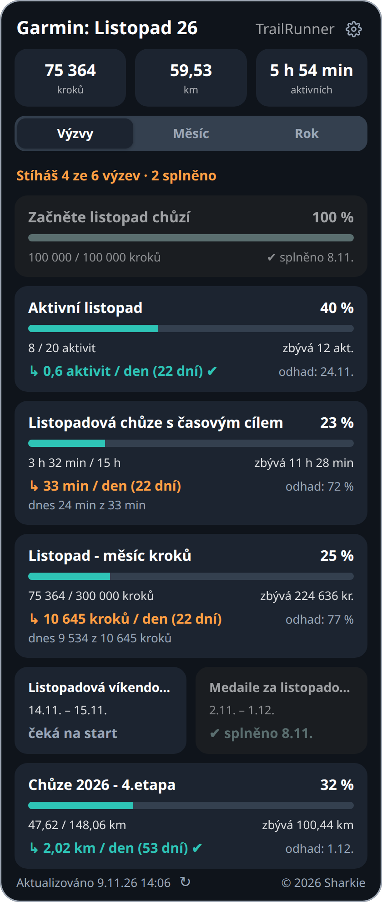
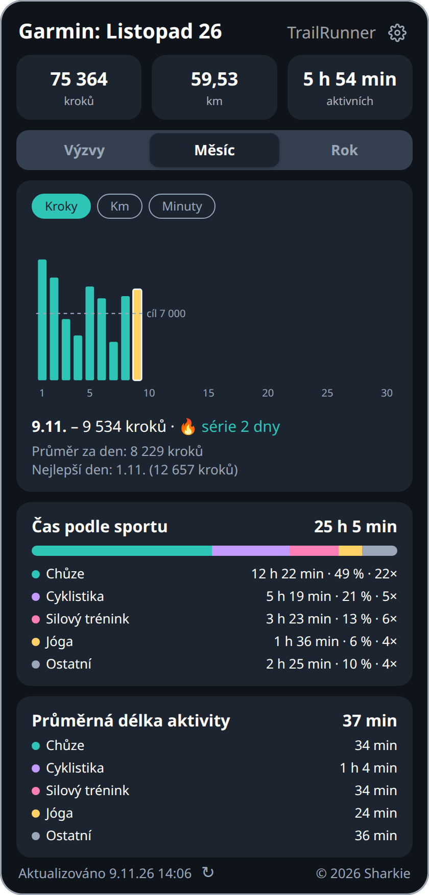
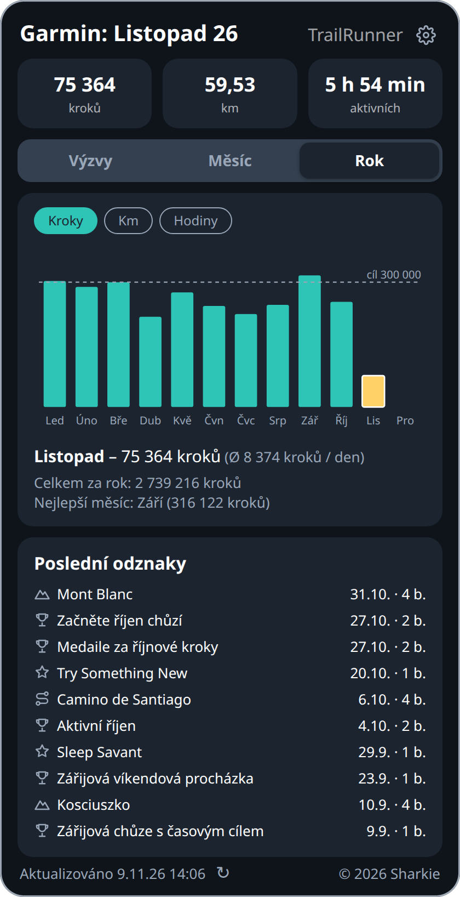
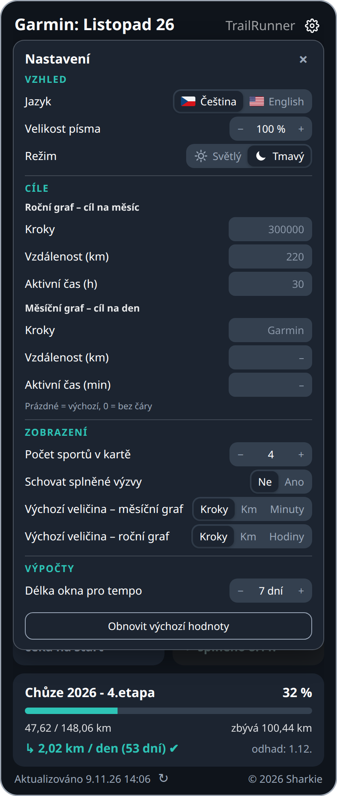
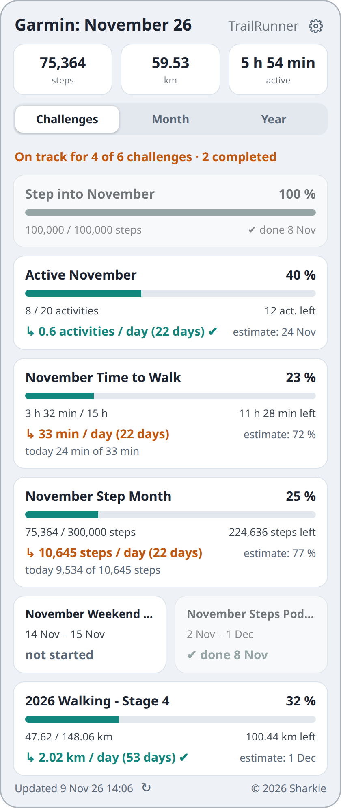
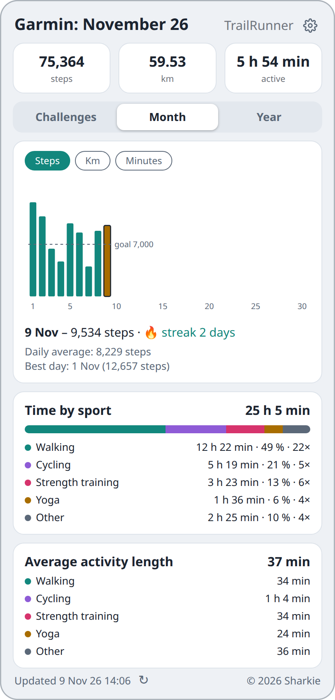
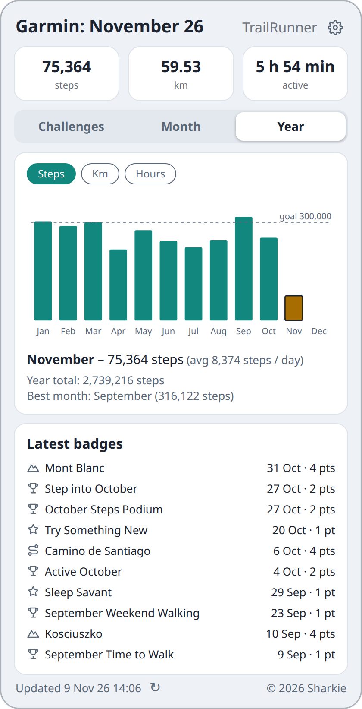
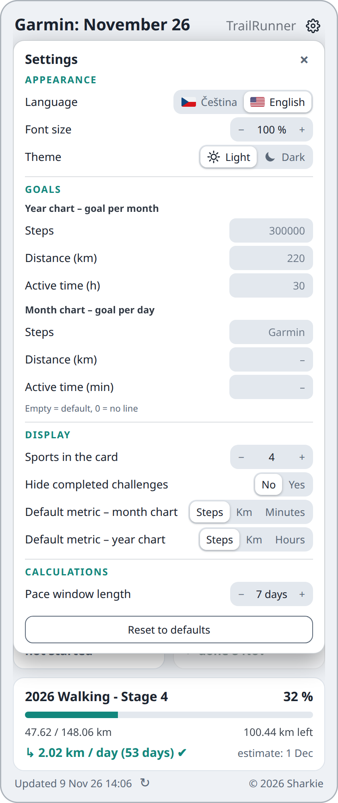

# Garmin challenges widget

Downloads this month's steps, km, active minutes and challenges from Garmin Connect and shows them as a web widget.

## Screenshots

The screenshots show random demo data (`docs/demo-data.json`), not real Garmin data. The dark ones are in Czech, the light ones in English. They are generated by `python3 docs/make_screenshots.py` (needs Google Chrome and Pillow); re-run it whenever a change alters how the widget looks.

<p>

&ensp;
&ensp;
&ensp;
</p>

<p>

&ensp;
&ensp;
&ensp;
</p>

| File | Purpose |
|---|---|
| `fetch_garmin.py` | downloads the data from Garmin into `data.json` |
| `garmin-widget.js` | the widget (embeddable in a web page) |
| `index.html`, `manifest.json`, `icon.svg` | standalone page, can be added to a phone's home screen |
| `server.py` | small server: serves the web page and runs a new download when ↻ is tapped (`POST /refresh`) |
| `names.cs.json`, `czech_names.py` | Czech challenge names (with month placeholders, `czech_names.py` fills in the right form of the month) |
| `order.json`, `hide.json` | display order and hidden challenges |
| `garmin-widget.service` | systemd service for the server |

The server never serves non-public files (`seen.json`, `raw_challenges.json`, `history.json`, `months.json`, `prev_daily.json`, `streak.json`, tokens).

The widget UI is available in Czech and English (switch with the CS/EN button). Challenge names come from Garmin in English; Czech names are kept in `names.cs.json`. The code and documentation are in English.

## Installation on a server (Raspberry / VPS)

Ubuntu Server 24.04; first run `sudo apt update && sudo apt install git python3-venv python3-pip`.

```bash
sudo mkdir -p /opt/garmin-widget && sudo chown $USER /opt/garmin-widget
git clone <repository-url> /opt/garmin-widget
cd /opt/garmin-widget
python3 -m venv venv && ./venv/bin/pip install -r requirements.txt
```

Updating later: `cd /opt/garmin-widget && git pull` (and `sudo systemctl restart garmin-widget` if `server.py` changed). When `requirements.txt` changed, or now and then to pick up fixes in the libraries that `garminconnect` depends on: `./venv/bin/pip install -U --upgrade-strategy eager -r requirements.txt` (a plain `pip install -r` leaves already installed dependencies as they are, even vulnerable ones).

### Garmin login (once)

Log in directly on the server (you will be asked for the MFA code):

```bash
GARMIN_EMAIL=... GARMIN_PASSWORD=... ./venv/bin/python fetch_garmin.py
```

The tokens are stored in `~/.garminconnect` (or in the directory given by the `GARMINTOKENS` environment variable), after which the password is no longer needed.

Do not share one token directory between two machines (for example by copying it from your computer to the server): Garmin rotates the refresh token on use, so whichever machine refreshes first invalidates the copy on the other one. Give every machine its own login (on your own computer e.g. with `GARMINTOKENS=~/.garminconnect-local`).

### Scheduled downloads (cron, every 30 min)

```
*/30 * * * * cd /opt/garmin-widget && ./venv/bin/python fetch_garmin.py >> fetch.log 2>&1
```

Garmin removes a challenge from its "non-completed" list once it is completed. The fetch remembers the challenges it has seen (`seen.json`) and confirms a vanished one against Garmin's earned badges, so a completed challenge stays visible (greyed out, with its completion date) until the end of the month. A vanished challenge without a matching badge (e.g. one you left) is dropped.

Every run also builds the start-of-day progress of each challenge (`hist` in `data.json`); the widget derives the recent pace from it. Where possible it is **computed from Garmin's per-day data**, following the rules Garmin uses for the challenges: steps per day (step challenges), total duration of walking activities ("walk N hours"), total distance of walking activities ("walk N mi") and the number of activities lasting at least 20 minutes ("N activities"). This also fills in the days before the first download. The computed sum must match the progress Garmin reports for the challenge; otherwise (or for challenges without a rule) the fetch falls back to **snapshots** of the progress taken at the first download of each day, stored in `history.json` (last 62 days). Until at least 3 days of history exist, the widget falls back to the average over the whole period so far. During the first 3 days of a challenge there is too little data to judge, so the widget assumes the challenge is on track (green, counted as on track in the summary) and shows no estimate yet. Rules live in `CHALLENGE_RULES` in `fetch_garmin.py`; challenges of other types simply use snapshots.

Cron must also run shortly after midnight (`*/30` does that – runs at 0:00 and 0:30). The first download of a new day stores the state of the challenges at the start of the day in `history.json`. The widget uses it to compute "today you already have X of Y", and the daily goal stays constant during the day.

### Server

1. In `garmin-widget.service` set `User` and `REFRESH_KEY` (a random string, e.g. `openssl rand -hex 16`).
2. `sudo cp garmin-widget.service /etc/systemd/system/ && sudo systemctl enable --now garmin-widget`
3. HTTPS: put a reverse proxy in front of the server, e.g. Caddy – `your.domain { reverse_proxy 127.0.0.1:8080 }` (it obtains the certificate by itself). Alternative without opening ports: Cloudflare Tunnel or Tailscale.
4. Set the key in `index.html`: `data-refresh-url="refresh?key=YOUR_KEY"`.
   The key is visible in the HTML to anyone who opens the page. It only protects against accidental triggering,
   and the server downloads at most once per `REFRESH_MIN_GAP` seconds (default 300), which also limits how often your Garmin account is queried by strangers. If the site is public and you do not want
   everyone to see your steps, put a login in front of it (e.g. Basic auth in Caddy).

### Embedding in another site

```html
<div id="garmin-widget" data-src="https://your.domain/data.json"
     data-refresh-url="https://your.domain/refresh?key=YOUR_KEY"></div>
<script src="https://your.domain/garmin-widget.js"></script>
```

On the server then set `Environment=CORS_ORIGIN=https://target.site`.

Optional attributes on the widget element:
- `data-theme="light|dark"` – default theme (otherwise the phone setting is used); `data-theme-toggle="off"` removes the theme choice from the settings.
- `data-lang="cs|en"` – default language (otherwise the browser language is used, falling back to English); `data-lang-toggle="off"` removes the language choice from the settings.
- `data-settings="off"` – hides the gear (and with it the whole settings panel). The gear next to the name opens a floating panel that covers the content below the header (it closes with the cross, the gear, a click outside or `Esc`) with the choices that are not switched off; your choices are remembered in the browser.
- `data-pace-days="7"` – default for how many of the last complete days are used to compute the pace (the colour of the daily-average line and the estimate on the right). Default 7, range 2–60. Needs a few days of history (see "Scheduled downloads").
- `data-reload-minutes="15"` – how often an open page re-reads `data.json` (minutes, default 15, minimum 1, `0` turns the automatic reload off). This only reloads what the server already has; fresh data from Garmin still depends on the cron job and the ↻ button.
- Robustness on mobile networks: a failed request is retried up to 3 times (after 2, 4 and 6 seconds) and never wipes what is shown; if it still fails, the last known data stays with a ⚠ next to the update time. The widget also reloads when the page returns to the foreground or the network comes back (if the data is older than 2 minutes).
- `data-tab="challenges|month|year"` – the tab shown at start (otherwise the last tab used, remembered in the browser).
- `data-badges="10"` – how many of the latest earned badges the Year tab lists (default 10, maximum 30).
- `data-year-goal-steps="300000"`, `data-year-goal-km="220"`, `data-year-goal-hours="30"` – default goal lines in the monthly bar chart of the Year tab (steps, km and active time per month; the time goal is given in hours). Use `0` to hide a line.

The choices made with the buttons are remembered in the browser (`localStorage`).

## Settings

The gear next to the name opens a floating settings panel (it covers the content below the header and closes with the cross, the gear, a click outside or `Esc`). The choices are remembered in the browser. For every setting the order of precedence is: **the visitor's choice in the browser, then the attribute in the HTML (the default of the site), then the built-in default**; an empty number field means "use the default".

| Group | Setting | Default |
|---|---|---|
| Appearance | Language (Čeština / English) | browser language |
| | Font size (90 / 100 / 110 / 120 %, the whole widget is scaled) | 100 % |
| | Theme (light / dark) | phone setting |
| Goals | Year chart – goal per month: steps, km, active hours (`0` = no line) | 300 000 / 220 / 30 |
| | Month chart – goal per day: steps, km, active minutes (`0` = no line) | steps: Garmin's daily goal, km / minutes: no line |
| Display | Number of separate sports in the sports cards (all the others are merged into one "Other" row, even when it is just one sport) | 4 |
| | Hide completed challenges | no |
| | Default metric of the month chart and, separately, of the year chart (steps / km / minutes) | steps / steps |
| Calculations | Pace window length in days (2 – 60) | 7 |
| Charts | The "vs previous month" / "vs last year" pills (they remember their state; attributes `data-compare-month="on"` / `data-compare-year="on"` set the default) | off |

The button **Reset to defaults** at the bottom of the panel (it asks for a second tap) removes all choices of the visitor, including language and theme, which then return to what the HTML attribute, the browser language and the phone say.

## Tabs

On touch screens the tabs can also be switched by swiping the widget left or right (a quick horizontal swipe of at least 60 px; slower or mostly vertical gestures are ignored, so scrolling still works).

- **Challenges** – the challenge cards (progress, daily goal, pace, estimate). Percentages are rounded down, so 100 % is shown only for a really completed challenge (the estimate of a challenge that is not on pace never shows 100 % either). The other numbers are rounded the careful way too: what you have done is rounded down, the goal, the amount left and the daily goal are rounded up, so "1.2 of 1.2 km" never appears for an unfinished challenge; kilometres are shown with up to two decimals. When today's quota is reached, a ✔ follows the daily goal; until then a line "today X of Y" shows how far you are.
  - **Summary line** above the cards, e.g. "On track for 4 of 6 challenges · 2 completed", or "🎉 Congratulations! All challenges completed". Completed challenges count as on track. A challenge that has not started yet counts as on track, and so does any challenge in its first 3 days (too little data to judge, no estimate is shown yet). Challenges without a percentage (e.g. the weekend walk) count too: completed when earned, on track while running or not started, missed once ended.
  - **Which month a challenge belongs to:** a challenge longer than a month (e.g. one running for 3 months) is shown every month at the very bottom, but counts in the summary only in the month it ends. A short challenge that straddles a month break (a weekend, 4 weeks) counts in the month that holds most of its days (a tie goes to the later month) and is not shown any more once that month is over, even if it still runs for a day or two into the next one.
- **Month** – a bar chart of steps / km / active minutes for every day of the current month (switch with the pills above the chart; each of the two charts remembers its own choice; tap a bar to see its day; for steps the dashed line follows the daily step goal set in Garmin, which can change from day to day; the yellow bar is today). The per-day values come from the `daily` list in `data.json`. Below the chart a card shows the time spent per sport this month (stacked bar and list with time, share and number of activities; the top 4 sports, the rest merged into "other"), from the `sports` list in `data.json`. It is the duration of the recorded activities, not Garmin's intensity minutes. A second card shows the average length of one activity per sport (and overall), computed from the same list.
  - **Streak:** for steps the line under the chart also shows the series of days in a row with the daily step goal reached, counted up to the selected day, with your record next to it, e.g. "🔥 streak 5 days · record 25". The days of this and the previous month come from `daily` and `prev`, the part of the series before them and the record from `data.streak`, which `fetch_garmin.py` scans from the whole step history once a day (cached in `streak.json`; the first run makes a few dozen requests).
  - **Comparison:** the pill "vs previous month" replaces the bars with running totals of the chosen metric – this month (solid line, up to today) against the previous month (dashed, whole month) – with the difference on the same day and an estimate for the end of the month (the average of the complete days so far). The per-day values of the previous month come from `data.prev` (cached in `prev_daily.json`).

- **Year** – a bar chart per month of the current year (steps / km / active hours, same pills; tap a bar for the month and its daily average; the yellow bar is the running month; the dashed line is a configurable monthly goal), plus the year total and the best month. The data is the `year` list in `data.json`. Below it a card lists the latest earned badges (name, date, points) from the `badges` list; badge names use `names.cs.json` like challenges do (names without a translation stay in English). Expeditions (Garmin's `virtual_*` badges) are recognised automatically: they keep their English names and get an icon – a mountain for a climb (elevation goal) or a route for a hike (distance goal). Totals of finished months are computed once and cached in `months.json`; the first run on a new installation therefore needs about two minutes (limited to 150 seconds per run, the rest is finished by the next run), later runs only recompute the running month. The previous month is recomputed during the first 3 days of a month to catch late synced data. **Comparison:** the pill "vs last year" puts last year's bar (grey) next to every month and compares the finished months of both years; last year's totals are computed once on the first run (a few minutes, within the same time limit) and stored in `months.json`; they come to the widget as `year.prev`.

## Security notes

- The server only serves a whitelist of files and sends `nosniff`, `no-referrer` and `X-Frame-Options: DENY`; it does not advertise its version and never returns server paths in the `/refresh` answer (details go to the server log).
- The personal files written by `fetch_garmin.py` (`data.json`, `history.json`, `months.json`, `prev_daily.json`, `streak.json`, `seen.json`, `raw_challenges.json`) are created with permissions `600` (owner only); the systemd unit runs with `UMask=0077` and a set of hardening options.
- The widget escapes every text from `data.json` and forces numbers to real numbers before they go into the page.
- `garminconnect` is pinned in `requirements.txt`; run `pip-audit --path venv/lib/python3.*/site-packages` (it checks what is really installed, including the dependencies that are not pinned) before bumping it and from time to time.
- Recommended in the reverse proxy (Caddy), in the site block: `header { Strict-Transport-Security "max-age=31536000" ; X-Content-Type-Options nosniff ; X-Frame-Options DENY ; Referrer-Policy no-referrer ; -Server ; -Via }`, and `header_down -Server` and `header_down -Via` inside the `reverse_proxy` block (Caddy 2.11 adds a `Via: 1.0 Caddy` header, which tells everybody what runs in front of the page). Use the current Caddy from its official repository instead of the old one in the Ubuntu archive.
- Recommended on the server: SSH with keys only (`PermitRootLogin no`, `PasswordAuthentication no`, put them into a file that sorts before `50-cloud-init.conf`, e.g. `00-hardening.conf`) and automatic security updates (`unattended-upgrades`).

## What changes month by month

- New challenges are shown in English until they are translated – add them to `names.cs.json` (the key is in `data.json`) and, if needed, to `order.json`.
- A Czech name that contains the month is written once with a placeholder and works for every month, e.g. `"Kroky {v_mesici}"` becomes "Kroky v listopadu". The month is taken from the key of the challenge (`..._2026_11`). Placeholders: `{mesic}` (říjen), `{v_mesici}` (v říjnu), `{mesicni}` (říjnová), `{mesicne}` (říjnové); with a capital first letter (`{Mesic}`, `{Mesicni}`, `{Mesicne}`) the form starts with a capital; see `czech_names.py`.
- A name that is different every month (no rule) is added for that month only, under the full key including year and month, e.g. `"challenge_total_step_300k_2026_11": "Listopad - měsíc kroků"`. An entry for the exact key wins over the general one; a month without any entry stays in English.
- The rest (month, totals, days left) is recalculated automatically.

## License

[PolyForm Noncommercial License 1.0.0](LICENSE) – free for personal use, study, research and other non-commercial purposes; **commercial use is not permitted**. This is a source-available license, not an open source one. The text is the unmodified official license from <https://polyformproject.org/licenses/noncommercial/1.0.0>.

This project is unofficial and is not affiliated with or endorsed by Garmin. It uses the unofficial [`garminconnect`](https://github.com/cyberjunky/python-garminconnect) library, which is subject to its own license.
